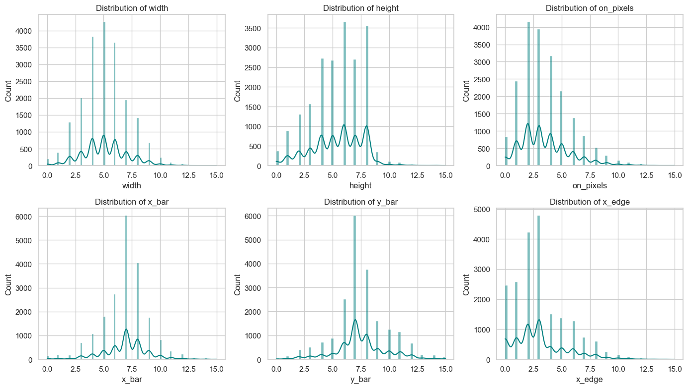
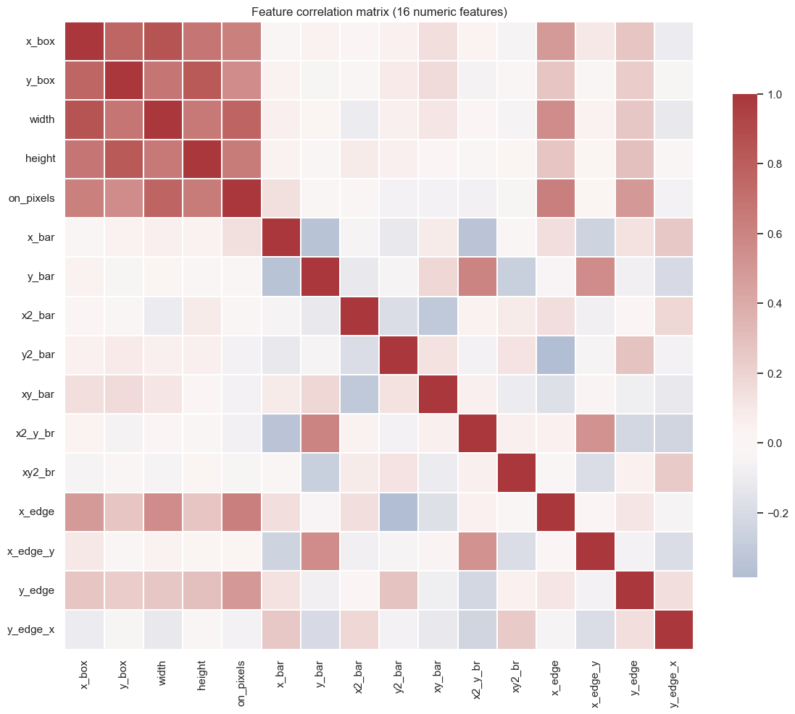
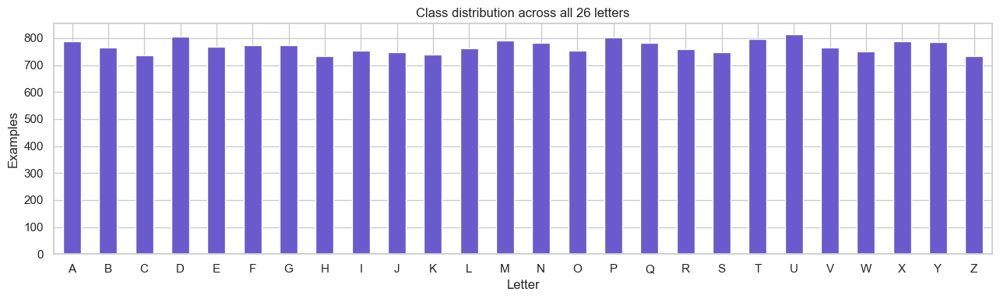
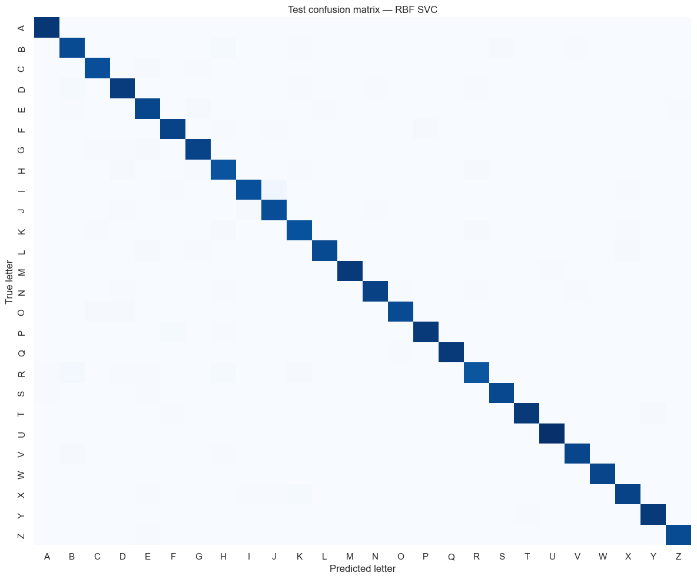

# Letter Recognition with Classical Machine Learning

This project classifies uppercase English letters (A–Z) from 16 numeric descriptors extracted from character images. It uses the UCI Letter Recognition dataset to explore the feature space, compare baseline and classical machine-learning models, tune model settings with stratified cross-validation, and examine the remaining errors.

## Results

The portfolio notebook used a stratified 80/20 train/test split (16,000 training rows and 4,000 held-out test rows). Model selection used three-fold stratified cross-validation on the training split. The table reports the observed results from the executed notebook; wall-clock times are specific to that run and machine.

| Model                 | Training / search time | Validation accuracy (3-fold CV) | Test accuracy |
| --------------------- | ---------------------: | ------------------------------: | ------------: |
| Dummy (most frequent) |                  4.5 s |                           4.06% |         4.08% |
| Random Forest         |                 20.7 s |                          95.53% |        97.03% |
| RBF SVC               |                  9.8 s |                      **96.38%** |    **97.48%** |
| MLP                   |                 14.7 s |                          93.89% |        95.20% |

The RBF SVC was selected from cross-validation and achieved 97.48% accuracy on the held-out set (3,899 of 4,000 examples correct). Its chosen settings were `C=10` and `gamma="scale"`. The Random Forest was close behind at 97.03%, while the MLP reached 95.20%. All three learned models substantially exceeded the 4.08% majority-class baseline. The test score is higher than the CV mean for the two strongest models in this split; results should be read as estimates from one fixed split, not as a guarantee of future performance.

### EDA and error analysis

- The class distribution is reasonably even: class counts range from 734 (H and Z) to 813 (U), or roughly 3.67%–4.07% of the dataset. Stratification was still used for fair evaluation.
- Measurements are integer-valued and bounded from 0 to 15. Several box and pixel-count features have noticeable correlations; the strongest pair is `x_box` with `width` (|r| ≈ 0.85), followed by `y_box` with `height` (|r| ≈ 0.82). The workflow keeps all features and lets model comparisons assess their usefulness.
- On the selected SVC, the most frequent directed confusion was I → J (6 examples), followed by R → B (4). This is a small number of errors per pair, rather than a dominant failure mode.
- R had the lowest recall (92.1%), followed by I (94.7%). H had the lowest precision (92.2%), followed by B (93.6%). These classes may share patterns in the compact geometric and edge descriptors with neighboring shapes; this is a plausible interpretation of the errors, not a causal finding.

### Figures

The figures below are saved as standalone files so they remain available when notebook outputs are cleared.

#### Feature distributions



#### Correlation across the 16 features



#### Class balance



#### Held-out confusion matrix for the selected RBF SVC



## Methodology

1. Load the headerless UCI data and assign names to the 16 numeric features and letter target.
2. Inspect data quality, descriptive statistics, feature distributions, pairwise feature correlation, and class counts.
3. Split data into stratified training and test subsets. Keep the test split untouched during model selection.
4. Compare a most-frequent `DummyClassifier` baseline, `RandomForestClassifier`, RBF-kernel `SVC`, and `MLPClassifier`.
5. Tune the Random Forest, SVC, and MLP with `GridSearchCV`, using the same shuffled `StratifiedKFold` (3 folds). Standardization is included inside the SVC and MLP pipelines to prevent fold leakage.
6. Rank models by mean CV accuracy, evaluate the selected model once on the held-out test set, then inspect its confusion matrix, common directed confusions, and per-class precision/recall.
7. Save the selected fitted pipeline and its feature schema in a `joblib` bundle.

The search spaces are intentionally compact: Random Forest searches `max_features`, `min_samples_leaf`, and a fixed 250-tree configuration; SVC searches `C` and `gamma`; MLP searches two hidden-layer structures and two `alpha` values. Refer to the notebook for the exact grids and code.

## Limitations

- The models use engineered 16-dimensional descriptors, not the original character images. They cannot recover visual details that were discarded during feature extraction.
- The notebook reports one stratified holdout and one CV configuration. It does not provide repeated-seed uncertainty estimates or a statistical significance test between the top models.
- The input file contains 1,332 duplicate full rows according to the notebook's exact-row check, despite the dataset description referring to 20,000 unique stimuli. A random split can therefore place identical feature/label rows in both training and test sets, potentially making the test score optimistic. A stricter follow-up would group exact duplicates so each group stays in one split.
- Hyperparameter grids are small and limited to four model families. Broader search, calibration, inference latency, and testing on data from new fonts or acquisition settings are outside this project.
- The output is a local scikit-learn artifact and has not been wrapped in a production API or monitored after deployment.

## Dataset and reference

The data is the [UCI Machine Learning Repository Letter Recognition dataset](https://doi.org/10.24432/C5ZP40), donated by David J. Slate. It contains 20,000 examples described by 16 integer-valued measurements and a target letter. The original publication listed in the dataset documentation is:

> Frey, P. W., & Slate, D. J. (1991). Letter recognition using Holland-style adaptive classifiers. _Machine Learning, 6_, 161–182. https://doi.org/10.1007/BF00114162

The dataset is not included.

## Project contents

- `letter_recognition.ipynb` — experiment notebook
- `letter_recognition_model.joblib` — Fitted model bundle
- `figures/` — Figures generated from local run
- `data/` — Dataset (not included)
- `requirements.txt` — dependencies

## Reproducibility

Use Python 3.10 or newer. From the project root, install the notebook dependencies:

```bash
pip install -r requirements.txt
```

Launch Jupyter and run the portfolio notebook from top to bottom:

```bash
jupyter notebook letter_recognition_portfolio.ipynb
```

The notebook expects the data file at `data/letterrecognition/letter-recognition.data`. It uses random seed 42 for the split, CV folds, and model initialization. Running all model searches should take under a minute on a comparable machine, but timings vary by hardware and software versions. On completion, the final cells save the selected model bundle to `artifacts/letter_recognition_model.joblib`.

## Author and License

_Author: Lucy Giang (lucy-giang3), updated Mar. 2026_

This code is shared for free for learning and personal use only. Commercial use is prohibited.
