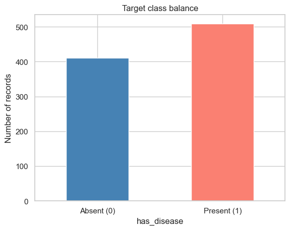
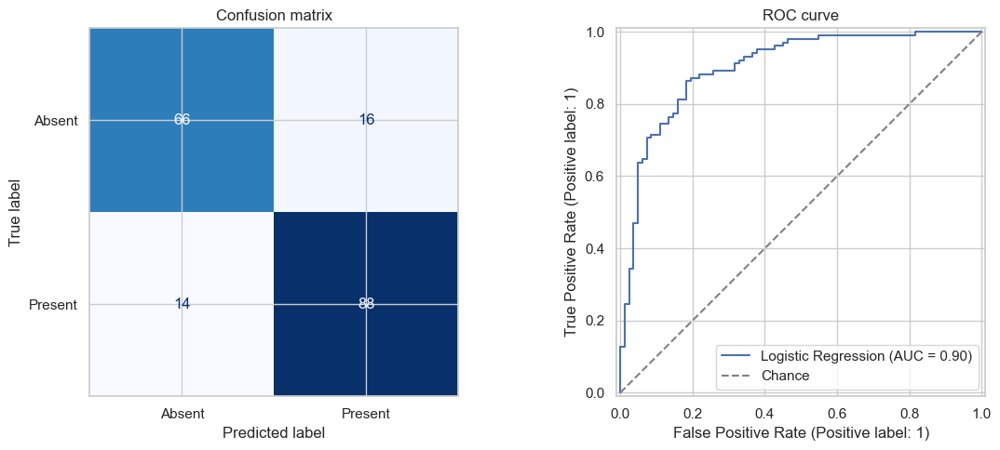
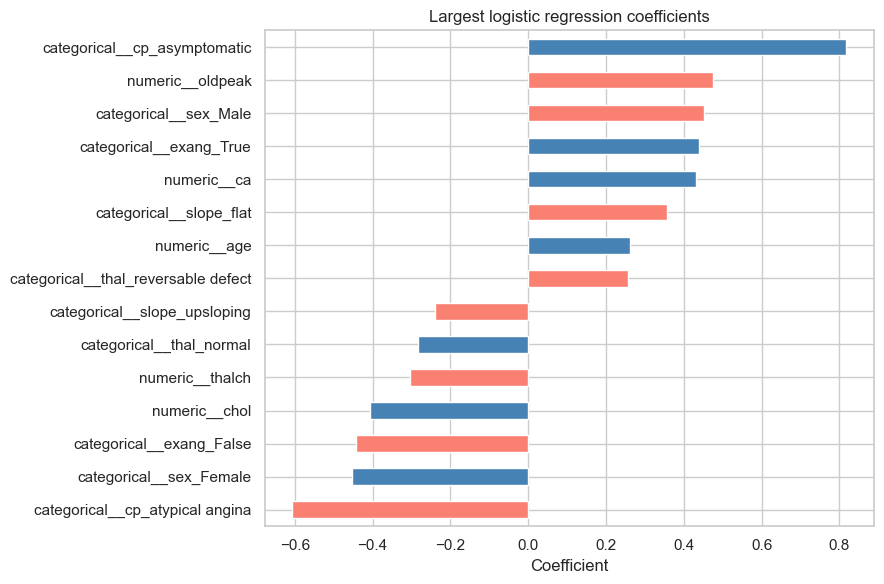

# Heart Disease Prediction: Results and Analysis

_Author: Lucy Giang, updated Jan. 2026_

## Overview and Objective

This notebook predicts a binary label from the UCI Heart Disease dataset distributed through Kaggle: `has_disease = 1` when the original diagnosis severity `num` is greater than zero, and `0` when it is zero. This is an educational modeling exercise, not a clinical decision tool.

## Exploratory data analysis

The source CSV contains **920 rows and 16 columns**: 13 candidate predictors, an identifier (`id`), a source-site label (`dataset`), and the diagnosis (`num`). The raw target has five levels: 0 (411 records), 1 (265), 2 (109), 3 (107), and 4 (28). Collapsing levels 1-4 creates 509 positive examples and 411 negative examples, so the positive prevalence is **55.3%**.

The data combine four source sites. The notebook removes `id`, because it is an identifier, and `dataset`, because site may act as a shortcut and may not generalize to a new population. The 13 retained predictors include six numeric fields (`age`, `trestbps`, `chol`, `thalch`, `oldpeak`, `ca`) and seven categorical or Boolean fields (`sex`, `cp`, `fbs`, `restecg`, `exang`, `slope`, `thal`).

Missingness is substantial in several clinical fields: `ca` is missing in 611 rows (66.4%), `thal` in 486 (52.8%), and `slope` in 309 (33.6%). Other fields have lower missingness, including `fbs` (9.8%), `oldpeak` (6.7%), `trestbps` (6.4%), `exang` and `thalch` (6.0% each), `chol` (3.3%), and `restecg` (0.2%). This makes pipeline-based imputation important, and it also means some model signals rely on imputed values. The notebook uses median imputation for numeric features and most-frequent imputation for categorical features.

A stratified 80/20 split with random seed 42 produced 736 training rows and 184 test rows. The positive class prevalence was 55.3% in training and 55.4% in testing, as intended by stratification.

_Figure 1. Binary target distribution across all 920 records._

## Methodology and design choices

Preprocessing and estimation are combined in scikit-learn pipelines. Numeric features are median-imputed and standardized. Categorical features are filled with their most frequent training value and one-hot encoded, with unknown categories ignored. Because each transformer is fitted inside cross-validation, validation folds and the held-out test set do not determine imputation values, scaling statistics, or category encodings.

Two class-weighted model families were compared: logistic regression (`max_iter=2000`) and random forest (`n_estimators=400`, `min_samples_leaf=2`). Both use seed 42. `class_weight='balanced'` makes each model account for class frequency during fitting, although the classes are only moderately imbalanced here.

The training set was evaluated with five-fold stratified cross-validation, using ROC AUC, F1, and balanced accuracy. Baseline model-family selection used mean cross-validation ROC AUC. A compact `GridSearchCV` then tuned only the selected family, again using five-fold stratified CV and ROC AUC as the selection metric. The held-out test set was reserved for one final evaluation after fitting the best training-CV pipeline.

ROC AUC evaluates ranking over possible thresholds; F1 and the classification report use the estimator's default 0.5 probability threshold. These summarize different properties. No threshold was optimized for clinical costs, no calibration analysis was performed, and no external or site-held-out validation was run.

## Experiments and measured results

### Baseline cross-validation on the training set

| Model               | ROC AUC mean ± SD |    F1 mean ± SD | Balanced accuracy mean ± SD |
| ------------------- | ----------------: | --------------: | --------------------------: |
| Logistic Regression |   0.8850 ± 0.0216 | 0.8170 ± 0.0161 |             0.7994 ± 0.0260 |
| Random Forest       |   0.8827 ± 0.0260 | 0.8222 ± 0.0242 |             0.7967 ± 0.0440 |

The baseline ROC AUC difference is just **0.0024**, small compared with fold-to-fold variation. Logistic regression was selected because it had the highest mean ROC AUC, but these results do not establish a meaningful or statistically significant advantage over the random forest. The forest had a slightly higher mean F1, while logistic regression had slightly higher mean balanced accuracy.

### Tuned logistic regression

Grid search selected `C=0.1` and solver `lbfgs`; the mean training-fold ROC AUC was **0.887**. `C=0.1` applies stronger regularization than the default `C=1`, which is a reasonable choice for a modest dataset with one-hot encoded predictors. The tuned CV score is only slightly above the baseline logistic-regression CV mean (0.885), so tuning produced a modest change rather than a dramatic gain.

On the 184-row held-out test set, the fitted pipeline achieved:

| Metric                      | Test result |
| --------------------------- | ----------: |
| Accuracy                    |       0.837 |
| Balanced accuracy           |       0.834 |
| Precision (disease present) |       0.846 |
| Recall (disease present)    |       0.863 |
| F1 (disease present)        |       0.854 |
| ROC AUC                     |       0.902 |

The confusion matrix at the default threshold is **TN=66, FP=16, FN=14, TP=88**. In this particular test split, the model identified 88 of 102 positive cases and correctly rejected 66 of 82 negative cases. It missed 14 positive cases and labeled 16 negative cases as positive. These counts illustrate the tradeoff at the chosen default threshold; they do not imply the same error rates in a different population.

The held-out ROC AUC (0.902) is higher than the training-CV mean (0.887). That can happen from ordinary sampling variation on a test set of only 184 examples; it is not evidence that performance will improve in deployment. The test estimate remains uncertain, and this dataset's source and sampling may limit generalization.

_Figure 2. Held-out test confusion matrix (left) and ROC curve (right). The matrix uses the default 0.5 threshold; ROC AUC summarizes ranking across thresholds._

## Coefficient interpretation

The fitted logistic regression coefficients are on transformed inputs: numeric values are standardized, and categorical values are one-hot encoded. The largest absolute coefficients included `cp_asymptomatic` (+0.818), `cp_atypical angina` (-0.607), standardized `oldpeak` (+0.475), `sex_Female` (-0.454), `sex_Male` (+0.452), `exang_True` (+0.440), standardized `ca` (+0.431), standardized `chol` (-0.407), and `slope_flat` (+0.357).

_Figure 3. The 15 largest absolute coefficients. Positive values shift predictions toward disease presence and negative values away from it, conditional on the other transformed inputs._

A positive coefficient raises the model's log odds for the positive class, conditional on its other inputs; a negative coefficient lowers them. For one-hot encoded categories, a coefficient is interpreted relative to the omitted reference category, so the displayed category coefficient alone is not a complete comparison. Numeric coefficients correspond to a one-standard-deviation change after imputation and scaling. Correlated predictors, missingness, and the dataset composition affect these estimates. Coefficients describe this fitted model; they do not establish causes, independent clinical effects, or biological importance.

## Results Analysis

The notebook demonstrates a coherent supervised-learning workflow: keep the diagnosis out of the features, remove identifiers and site, fit imputation and encoding within pipelines, compare model families with training-only CV, tune the selected family, and reserve a stratified holdout for final evaluation. On this split, the fitted logistic regression separates the classes reasonably well by ROC AUC and has balanced accuracy above 0.83, with positive-class recall higher than precision.

These results should be treated as a small-sample benchmark. The dataset pools multiple sites, but a random split can place records from the same sites in both training and testing. Site-specific patterns may therefore be shared across the split. The large amount of missingness in `ca`, `thal`, and `slope`, the limited sample size, and the absence of external validation all constrain claims about generalization. A next analysis could use site-aware validation, confidence intervals or repeated splits, calibration and threshold analysis, and subgroup error review. Clinical use would require much stronger validation and domain oversight.

The saved `heart_disease_model.joblib` contains the fitted preprocessing and tuned logistic-regression pipeline. Loading it requires compatible Python/scikit-learn dependencies; only load trusted joblib files. The model should not be used to diagnose or guide treatment.
