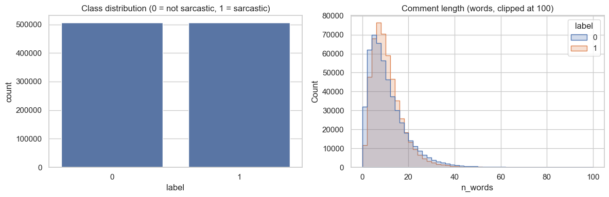
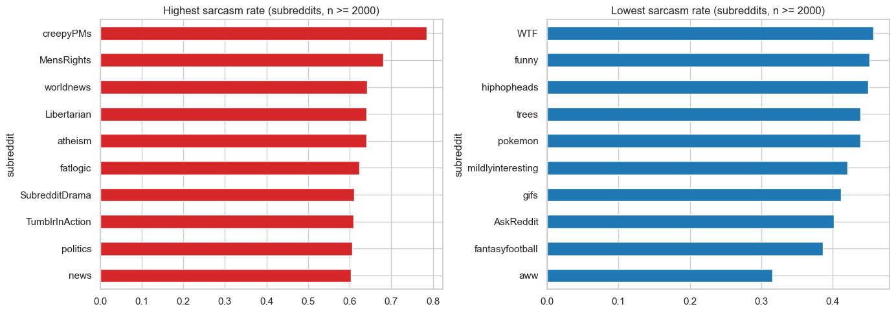
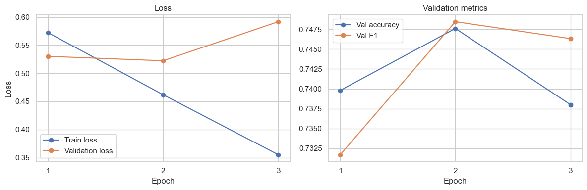
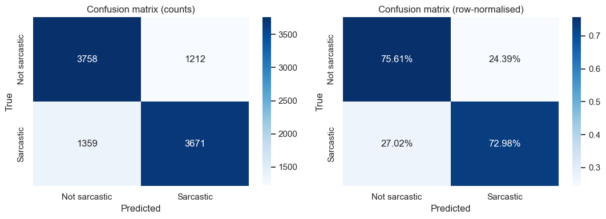
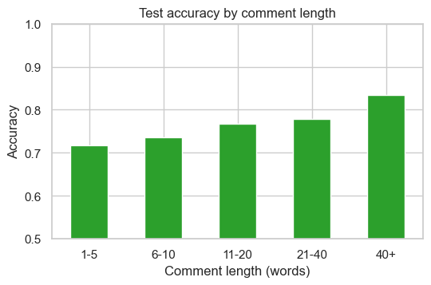
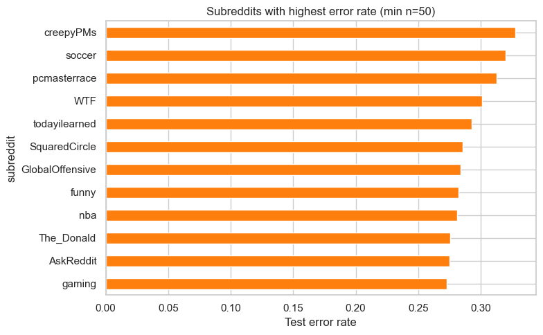

# Experiment Report

_Author: Lucy Giang, updated Aug. 2026_

## Summary

On the held-out test set of 10,000 comments, TF-IDF + Logistic Regression achieved 68.93% accuracy and 0.6809 sarcastic-class F1. Fine-tuned `bert-base-uncased` achieved 74.29% accuracy and 0.7406 F1 using the reply comment alone, and 74.67% accuracy and 0.7482 F1 when the parent comment was added as context.

Relative to the baseline, that is an absolute gain of 5.36 percentage points in accuracy (0.0597 F1) without context and 5.74 points (0.0673 F1) with it. Adding the parent comment improved accuracy by 0.38 points and F1 by 0.0076 over reply-only BERT. This is a small difference from one training run per setting, so it is suggestive rather than established.

BERT's gains come at a large cost: about 2.9 hours of CPU training per epoch, and measured inference of 42.9 ms per comment for the parent-context model versus 0.023 ms for the baseline, roughly 1,900 times slower.

## Data and Method

The source was SARC's balanced Reddit sarcasm dataset (1,010,826 rows). Removing missing comments and duplicate comment text left 962,293 rows. A stratified sample of 100,000 was divided into 80,000 training, 10,000 validation, and 10,000 test examples (seed 42); each split had a sarcastic share of approximately 50.3%.

The baseline used word unigram and bigram TF-IDF features with Logistic Regression. BERT fine-tuned `bert-base-uncased` for three epochs in each of two settings: reply comment only, and parent comment plus reply as a sentence pair (parent as the first segment). Both settings used the same splits, seed, hyperparameters, and a maximum length of 64 tokens, and each selected its checkpoint by validation F1. Training ran on CPU without mixed precision.

### EDA

_Figure 1. Left: class distribution of the full dataset. Right: comment length in words (clipped at 100), split by label._

The dataset is balanced: both classes contain 505,413 comments before cleaning. This is why accuracy is a meaningful metric here, but it also means the scores do not reflect real-world conditions, where sarcasm is much rarer. The length histogram shows that sarcastic and non-sarcastic comments have broadly similar length profiles. The median is 8 words for non-sarcastic and 9 for sarcastic comments, and the means are 10.6 and 10.3. Non-sarcastic comments have a heavier tail (maximum 2,222 words versus 276) and a spike of very short comments, while sarcastic comments cluster slightly more around 5 to 12 words. Length alone is therefore not a strong shortcut for the classifiers.

_Figure 2. Subreddits with at least 2,000 comments, ranked by the share of comments labeled sarcastic. Left: the ten highest. Right: the ten lowest._

The sarcasm rate varies considerably by community even though the overall dataset is balanced. creepyPMs is the highest at roughly 0.78, followed by MensRights, worldnews, Libertarian, and atheism, while aww is the lowest at roughly 0.32, followed by fantasyfootball and AskReddit. Discussion-heavy and political communities lean sarcastic, while image-sharing and hobby communities lean non-sarcastic. These rates reflect how the dataset was sampled and labeled (the label comes from Reddit sarcasm conventions), so they should not be read as the true prevalence of sarcasm in each community. They do matter for modeling, because subreddit topic and vocabulary can act as a signal the models pick up.

## Held-Out Test Results

| Model                        | Context        | Accuracy | Sarcastic F1 | Latency / comment |
| ---------------------------- | -------------- | -------- | ------------ | ----------------- |
| TF-IDF + Logistic Regression | Reply only     | 0.6893   | 0.6809       | 0.0228 ms         |
| BERT (`bert-base-uncased`)   | Reply only     | 0.7429   | 0.7406       | Not measured      |
| BERT (`bert-base-uncased`)   | Parent + reply | 0.7467   | 0.7482       | 42.93 ms          |

_Table 1. All models use the same stratified test split (n = 10,000). Latency is average inference time per comment on CPU; the BERT figure is for the parent-context model at batch size 64, includes tokenization, and is a single run. Latency for the reply-only BERT model was not measured._

## Training and Validation Results

| Epoch | Train loss | Validation loss | Validation accuracy | Validation F1 |
| ----- | ---------- | --------------- | ------------------- | ------------- |
| 1     | 0.5723     | 0.5302          | 0.7398              | 0.7317        |
| 2     | 0.4618     | 0.5223          | 0.7476              | 0.7485        |
| 3     | 0.3551     | 0.5919          | 0.7380              | 0.7463        |

_Table 2. Metrics for the reply-only BERT run. The selected checkpoint is epoch 2, which had the highest validation F1. The notebook did not print per-epoch validation metrics for the parent-context run, so its selected epoch is not recorded._

_Figure 3. Reply-only BERT training. Left: training and validation loss per epoch. Right: validation accuracy and F1 per epoch._

The left panel shows the classic signature of overfitting. Training loss falls steadily across all three epochs (0.5723 to 0.3551), but validation loss bottoms out at epoch 2 (0.5223) and then climbs to 0.5919. The right panel shows that validation accuracy and F1 both peak at epoch 2 as well, with F1 at 0.7485, and decline slightly in epoch 3. The model keeps fitting the training data after epoch 2 but generalizes slightly worse. Because the checkpoint was selected by validation F1, the epoch-2 weights were retained, so the final test numbers are not affected by the epoch-3 decline. This suggests two epochs may be enough, which would save about a third of the training time, although the learning-rate schedule was set for three epochs, so a two-epoch run would need to be tested directly.

## Analysis

Both BERT variants outperformed the lexical baseline. Reply-only BERT improved accuracy by 5.36 points and F1 by 0.0597; parent-context BERT improved them by 5.74 points and 0.0673. The near-balanced test set makes accuracy interpretable, and the F1 gains show the improvement is not limited to overall correctness. For reply-only BERT, sarcastic-class precision was 0.7518 and recall was 0.7298, so its sarcastic predictions were somewhat more precise than complete.

Parent context gave a small improvement: +0.38 points in accuracy (0.7429 to 0.7467) and +0.0076 in F1 (0.7406 to 0.7482). For scale, the binomial standard error of a single accuracy estimate on 10,000 examples is about 0.4 points, each setting was trained once with seed 42, and no paired significance test was run. The result is consistent with a modest benefit from conversational context but does not demonstrate one. The effect may also be understated because the sentence-pair input shared the 64-token limit, which likely truncated longer parent comments (the reply-only run truncated 0.4% of examples; truncation was not measured for pair inputs).

Each reply-only BERT epoch took approximately 10,279 to 10,380 seconds on CPU, or about 2.9 hours; training time for the parent-context run was not recorded. At inference, the parent-context model took 42.93 ms per comment versus 0.0228 ms for the baseline, about 1,900 times slower. The baseline timing was a single run without warm-up or repeat trials, and the BERT timing used longer sentence-pair inputs, so the ratio is approximate and the reply-only BERT latency is likely lower. Training duration and inference latency are separate costs and should not be conflated.

## Error Analysis

The confusion matrix and precision/recall figures describe the reply-only model, while the length, subreddit, vote, and example analyses below were computed on the parent-context model, which was the model loaded when those cells ran. The parent-context model misclassified 2,533 of 10,000 test comments (25.33%).

### Confusion matrix (reply-only model)

_Figure 4. Reply-only BERT on the test set. Left: counts. Right: row-normalized rates._

Of 4,970 non-sarcastic comments, 3,758 were classified correctly and 1,212 were flagged as sarcastic (a false-positive rate of 24.39%). Of 5,030 sarcastic comments, 3,671 were detected and 1,359 were missed (a false-negative rate of 27.02%). Errors are spread fairly evenly across both classes, with the model slightly more likely to miss sarcasm than to invent it. That matches the precision (0.7518) being a little higher than recall (0.7298). There is no sign that the model collapsed toward one class.

### Accuracy by comment length (parent-context model)

| Comment length (words) | Test comments | Accuracy | Error rate |
| ---------------------- | ------------- | -------- | ---------- |
| 1-5                    | 2,520         | 0.7183   | 0.2817     |
| 6-10                   | 3,323         | 0.7367   | 0.2633     |
| 11-20                  | 3,126         | 0.7681   | 0.2319     |
| 21-40                  | 939           | 0.7785   | 0.2215     |
| 40+                    | 91            | 0.8352   | 0.1648     |

_Table 3. Parent-context BERT test accuracy by reply length. The 40+ bucket contains only 91 comments._

_Figure 5. Parent-context BERT test accuracy by reply length (y-axis starts at 0.5)._

Accuracy rises steadily with length, from 71.8% for replies of 1 to 5 words to 77.8% for 21 to 40 words. This is intuitive: very short replies such as "Totally relevant!" offer few lexical cues, and without the surrounding thread even a human would struggle to judge them. The 83.5% figure for the 40+ bucket looks like the best result, but with only 91 comments it carries a wide margin of error and should not be over-interpreted.

### Error rate by subreddit (parent-context model)

_Figure 6. The twelve subreddits with the highest test error rate, among those with at least 50 test comments._

The highest error rates were creepyPMs (32.8%, n = 61), soccer (32.0%, n = 100), pcmasterrace (31.3%, n = 208), WTF (30.1%, n = 103), and todayilearned (29.3%, n = 123). AskReddit, the largest slice at 629 comments, had a 27.5% error rate, against 25.3% overall. Notably, creepyPMs is also the subreddit with the highest sarcasm rate in Figure 2, though with only 61 test comments it is not possible to say whether the two are related. These slices are small, so differences between neighboring subreddits are within sampling noise, and the chart is best read as a list of places to look rather than a ranking of difficulty.

### Error rate by vote metadata (parent-context model)

Error rates varied little across vote metadata: 24.6% to 25.8% across the four score buckets and 23.9% to 26.5% across the five upvote buckets. There is no strong sign that the model does better or worse on comments the community rated highly. The downvote column fell into a single bucket (every value was 0 or below), so it carries no information for this analysis.

### Most confident errors

Among the ten most confident errors, nine were comments labeled not sarcastic that the model scored as sarcastic with 0.98 to 0.99 confidence, such as "Totally relevant!" and "Yeah, the entire cast was just so raw and perfectly acted!". This is a small, hand-inspected sample, but it suggests some errors reflect noisy or convention-derived labels rather than clear model failures.

## Limitations

Each configuration was trained once with a single seed, so differences of a few tenths of a point, including the parent-context gain, are within plausible run-to-run variation. Metrics from the reply-only and parent-context models are mixed across the confusion matrix, latency, and slice analyses as noted above; re-running those cells for one model would give a fully consistent set. The dataset is balanced and convention-labeled, so the reported scores do not establish performance at natural class prevalence or reliable detection of human intent. Subreddit and voting error rates are descriptive and can reflect topic mix and sampling rather than model bias.
