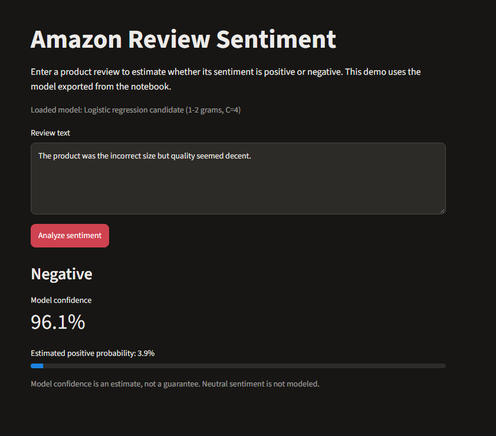
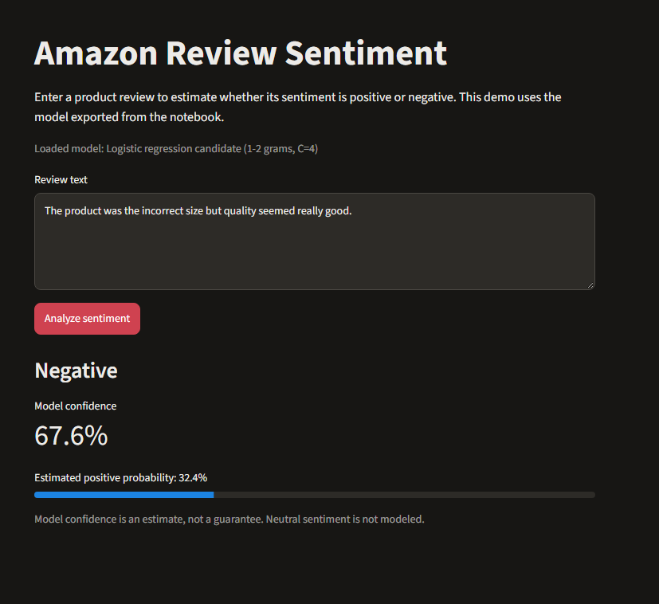
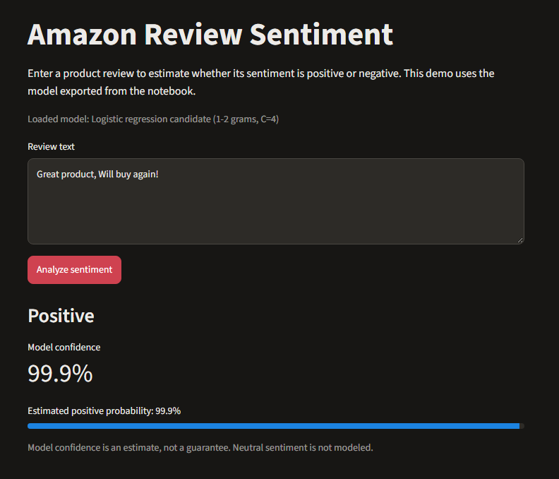

# Amazon Review Sentiment Analysis

An end-to-end binary sentiment classification project built around the Amazon Reviews Polarity dataset. The notebook compares interpretable classical NLP baselines, chooses a candidate with stratified cross-validation, evaluates it on a held-out test split, analyzes influential n-grams and confident errors, and exports a reusable inference pipeline. A small Streamlit app loads that artifact for interactive predictions.

## Project contents

- `amazon_review_sentiment.ipynb` — data loading, exploration, model comparison, evaluation, error analysis, interpretation, and artifact export.
- `app.py` — interactive review sentiment demo.
- `requirements.txt` — notebook and app dependencies.
- `sentiment_pipeline.joblib` — created by the notebook export cell after training.

## Run the notebook

Use Python 3.10 or newer. Create and activate a virtual environment, then install dependencies:

```bash
python -m venv .venv
# Windows PowerShell: .venv\Scripts\Activate.ps1
# macOS/Linux: source .venv/bin/activate
python -m pip install -r requirements.txt
```

Open `amazon_review_sentiment_v2.ipynb` in Jupyter and run all cells from a fresh kernel. Kaggle authentication may be needed for the first `kagglehub` download. The notebook uses a 100,000-row balanced training sample and a 50,000-row sample from the official test split by default. It compares models with three-fold stratified cross-validation on 18,000 training examples. These limits keep the workflow practical on a laptop; increase them or set them to `None` in the notebook for larger runs.

The CV table reports mean and standard deviation for accuracy and F1, mean ROC-AUC, mean fit time, and inference milliseconds per 1,000 reviews. The candidate with the highest mean CV F1 is refit on the training sample. The official test split is used only for the final report, not model selection. Run the notebook export cell to write `sentiment_pipeline.joblib` beside the notebook.

## Results from the included run

The 3-fold CV comparison selected the bigram logistic regression candidate. Test metrics below come from a 50,000-review sample of the official held-out test split. Latency is hardware-dependent and measured in the notebook's current environment.

| Model | CV accuracy | CV F1 | CV ROC-AUC | Mean fit time / fold | Inference ms / 1,000 |
| --- | ---: | ---: | ---: | ---: | ---: |
| Dummy majority | 0.5000 | 0.0000 | 0.5000 | 0.0019 s | 0.034 |
| MultinomialNB + unigram TF-IDF | 0.8395 | 0.8348 | 0.9190 | 0.7217 s | 59.288 |
| Logistic regression, unigram, C=1 | 0.8734 | 0.8733 | 0.9446 | 0.7792 s | 58.867 |
| Logistic regression, 1–2 grams, C=4 | **0.8896** | **0.8893** | **0.9572** | 2.8047 s | 117.855 |

Held-out test results: **92.03% accuracy**, **0.9204 positive-class F1**, and **0.9754 ROC-AUC**. These measurements are included as a record of this run; rerunning the notebook may produce small differences if the dataset version, sample, or environment changes.

## Launch the demo

After the notebook has created the model artifact:

```bash
streamlit run app.py
```

The app accepts one review and displays the predicted sentiment and the model's probability estimate. Its confidence should not be interpreted as a guarantee. The serialized pipeline is version-sensitive: install the pinned NumPy, pandas, scikit-learn, and joblib versions in `requirements.txt`, or retrain and re-export after changing those core package versions.

### Demo Examples

| Extremely Negative | Mildly Negative | Positive |
| :---: | :---: | :---: |
|  |  |  |

## Task definition and limits

The dataset contains review polarity labels derived from ratings: 1 and 2 are negative, 4 and 5 are positive, and neutral three-star reviews are omitted. The task is therefore binary polarity classification, not fine-grained opinion understanding. The notebook reports the test metrics generated by the current run instead of hard-coding a score. Performance on this historical benchmark may not generalize to new products, languages, or review patterns. The saved error review surfaces likely label noise: a few confident mistakes contradict the apparent review text. Inspect those examples against their source records before attributing every mismatch to the classifier.

## Dataset and reference

- [Amazon Reviews dataset on Kaggle](https://www.kaggle.com/datasets/kritanjalijain/amazon-reviews)
- Zhang, Zhao, and LeCun (2015), [Character-level Convolutional Networks for Text Classification](https://arxiv.org/abs/1509.01626)
